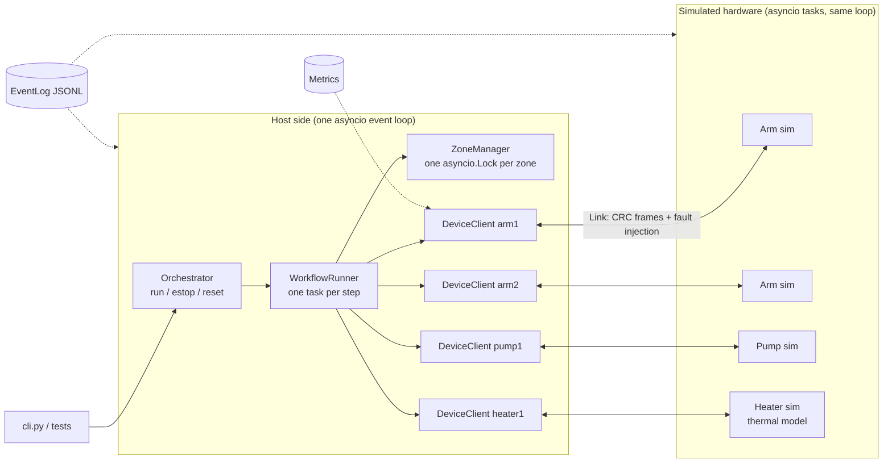
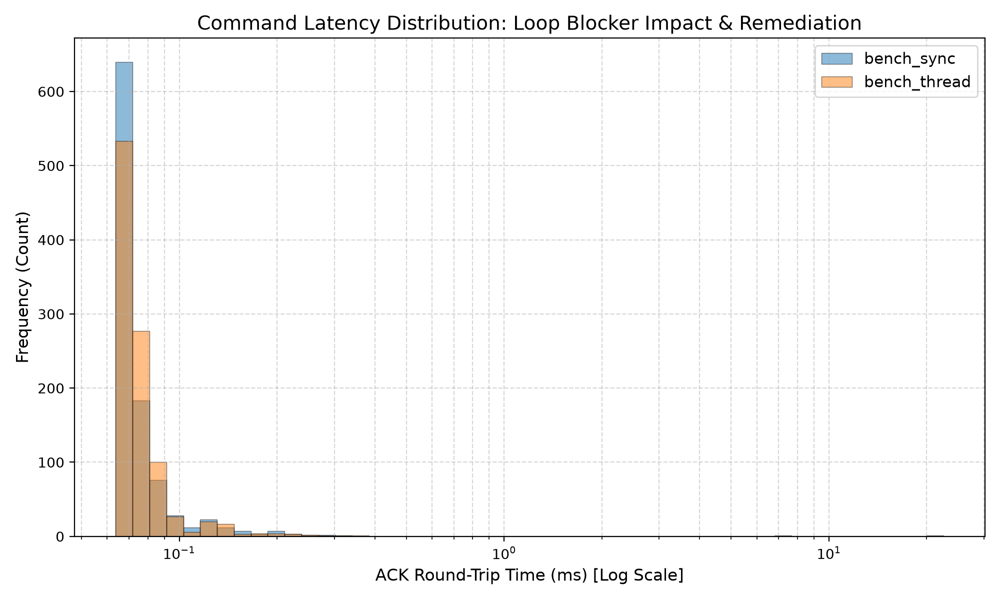

# Mini Lab Controller (`minilab`)

[](https://github.com/divyanshu/minilab-controller/actions/workflows/ci.yml)

**`minilab`** is an asynchronous Python controller that orchestrates a **simulated hardware** robotic laboratory workcell comprising two multi-axis positioning arms, a fluidic dispensing pump, and an active reaction heater. Built using Python's `asyncio` event loop, `minilab` implements a CRC32-framed wire protocol featuring acknowledgements (ACK), timeouts, retries, idempotent reply caching, spatial zone mutual exclusion, and concurrent emergency stop (e-stop) propagation under synthetic transport fault injection.

```text
Workflow 'basic'  status=SUCCESS  duration=1.15s
step       device     0s                                           1.15s

heat       heater1    |██████████████████████                            |  DONE
prime      pump1      |█████                                             |  DONE
move_a     arm1       |                      ████████                    |  DONE
dispense   pump1      |                              ████████████        |  DONE
home       arm1       |                                          ████████|  DONE
```

---

## Features

- **Concurrent Orchestration:** DAG-based workflow execution running independent steps in parallel and synchronizing dependencies via `asyncio.Event`.
- **Framed Wire Protocol:** String frames formatted as `<crc32_hex>|<json>` with two-phase command lifecycle (immediate ACK and eventual DONE/ERROR).
- **Idempotency & Replay:** Device simulators cache command execution outcomes, preventing dangerous duplicate actuations (e.g. double reagent dispensing) upon message retry.
- **Deterministic Fault Injection:** Reproducible transport-level drops, delays, duplicates, data corruption, and cable disconnects driven by string-seeded pseudo-randomness.
- **Spatial Zone Locking:** Hardware collision avoidance with canonical lock ordering to prevent actuator deadlocks, backed by watchdog timeouts and cycle detection.
- **Hardware-First E-Stop:** Synchronous latching that immediately dispatches e-stop frames to all devices concurrently, cancels active step tasks, releases zone locks, and drives subsystems into safe states.
- **Graceful Degradation:** Device offline fail-fast behavior that isolates broken hardware, skips dependent operations, and allows independent workflow branches to complete.
- **Performance Telemetry:** Microsecond-resolution latency distribution profiling ($p50$, $p90$, $p99$, $\text{Max}$) and structured JSON-lines event logging.

---

## Quickstart

### Prerequisites
- Python 3.11 or 3.12 (also tested on Python 3.14)
- Optional: `make` (standard on Linux/macOS, available on Windows via MinGW/Git Bash)

### Installation
```bash
git clone https://github.com/divyanshu/minilab-controller.git
cd minilab-controller
python -m venv .venv
# On Linux/macOS:
source .venv/bin/activate
# On Windows:
.venv\Scripts\activate
pip install -e ".[dev]"
```

### Running Commands
```bash
# Run test suite (59 tests)
pytest -q

# Run live ASCII Gantt demo
minilab run --scenario basic --time-scale 0.5

# List all available operational scenarios
minilab list

# Run a degraded execution scenario (pump failure skips dependent arm steps)
minilab run --scenario degraded

# Run latency benchmark suite and generate histogram
make bench
```

---

## Architecture



The host controller comprises an `Orchestrator` managing life-cycle and safety latching, a `WorkflowRunner` spawning an `asyncio.Task` per step, a `ZoneManager` enforcing spatial mutual exclusion, and individual `DeviceClient` instances communicating over simulated `Link` queues. Device simulators (`Arm`, `Pump`, `Heater`) run concurrently within the same event loop, communicating strictly over framed string queues.

---

## Reliability & Safety Architecture

| Mechanism | Implementation | Guarantee |
|---|---|---|
| **CRC32 Framing** | `messages.py` | Detects bit flips and payload truncations; rejects malformed frames without crashing readers. |
| **Idempotent Reply** | `devices/base.py` | Caches `_replies[msg_id]` so transport retries replay cached responses instead of repeating motion or fluid dispensing. |
| **Canonical Zone Locks** | `host/zones.py` | Sorts zone acquisitions lexicographically to eliminate circular wait conditions (deadlock prevention). |
| **Emergency Stop** | `host/orchestrator.py` | Concurrently transmits e-stop frames to all actuators, cancels in-flight operations, and latches until reset. |
| **Graceful Degradation** | `host/runner.py` | Device timeouts mark hardware offline; dependents are skipped while independent subsystems continue. |
| **Deterministic Seed** | `transport.py` | Fixed-order pseudo-random draws from string seeds guarantee identical fault decision sequences across runs. |

---

## Results & Benchmarks

> **Benchmark Notice:** Latency measurements below evaluate an in-process Python `asyncio` event loop running on a general-purpose operating system. They demonstrate cooperative scheduling dynamics and do **not** represent hard real-time hardware guarantees.

### Measured Command Latency Distribution ($N = 1,000$ Ping Commands)

| Blocker Workload | Description | Count | p50 | p90 | p99 | Max |
|---|---|---|---|---|---|---|
| `none` | Baseline (unloaded event loop) | 1,000 | 0.07 ms | 0.09 ms | 0.21 ms | 0.66 ms |
| `sync` | 20 ms synchronous loop blocker (`time.sleep`) | 1,000 | 0.07 ms | 0.09 ms | 0.20 ms | 20.51 ms |
| `thread` | Remediated via worker thread (`asyncio.to_thread`) | 1,000 | 0.07 ms | 0.09 ms | 0.20 ms | 6.87 ms |



- **Test Suite:** **59** automated integration and regression tests running in **< 17 s**.
- **Fuzz Testing:** **10** distinct pseudo-random seeds verified under heavy transport faults (15% drop, 10% dup, 5% corruption, 30% delay) with zero task or lock leaks.

---

## Planted Concurrency Bugs

See [`docs/BUGS_FOUND.md`](docs/BUGS_FOUND.md) for full reproduction traces, root-cause analyses, and regression tests.

1. **Bug #1: Actuator Lock-Order Deadlock (`deadlock-naive`)**
   Contending arms acquired shared zones in opposing order (`A->B` vs `B->A`), producing a circular wait hang. Fixed via canonical lexicographical lock ordering (`ordered=True`) and watchdog timeouts (`zone_timeout`).
2. **Bug #2: Retry Caused Double Dose on Non-Idempotent Device (`double-dispense`)**
   A dropped ACK frame prompted the host to retry a 5.0 mL dispense command, causing a non-idempotent pump simulator to dispense 10.0 mL. Fixed by caching replies by `msg_id` and replaying results on duplicate arrivals.
3. **Bug #3: Event Loop Stall from Synchronous Compute (`bench --blocker sync`)**
   A synchronous blocking call (`time.sleep(0.02)`) starved the cooperative event loop, spiking maximum latency from 0.66 ms to 20.51 ms. Fixed by offloading blocking workloads to background worker threads using `asyncio.to_thread`.

---

## Engineering Limitations (Honest Assessment)

- **Simulation Only:** All hardware devices are simulated Python classes; no physical motors, stepper drivers, or thermistors are connected.
- **Single Event Loop:** The entire workcell runs inside one Python process. While this simplifies state inspection and eliminates IPC serialization overhead, it is vulnerable to CPU-bound event loop starvation.
- **Not Hard Real-Time:** Standard general-purpose OS schedulers (Windows, macOS, Linux) cannot guarantee microsecond deadline execution bounds.
- **Porting to Physical Hardware:** Physical deployment requires:
  1. Replacing `Link` with hardware fieldbus drivers (CANopen, RS-485 Modbus, or EtherCAT).
  2. Replacing simulator tasks with embedded C/C++ firmware running on microcontrollers (FreeRTOS / Zephyr).
  3. Running the host control loop in a compiled language (C++ or Rust) on Linux with `PREEMPT_RT` patches, CPU isolation, and `SCHED_FIFO` real-time priorities.
  4. Adding hardware watchdog heartbeat relays.

---

## Project Structure & Extending Devices

```text
minilab-controller/
├── minilab/
│   ├── errors.py              # Custom exception hierarchy
│   ├── messages.py            # Message dataclass and CRC32 wire framing
│   ├── logs.py                # Structured JSON-lines logging
│   ├── metrics.py             # Latency percentiles and operational counters
│   ├── transport.py           # Deterministic fault injection channels and endpoints
│   ├── system.py              # SystemConfig assembly and async context manager
│   ├── scenarios.py           # Operational workflows and test scenarios
│   ├── report.py              # ASCII Gantt chart and summary rendering
│   ├── cli.py                 # CLI interface (run, bench, replay, trace, list)
│   ├── devices/
│   │   ├── base.py            # Device simulator base class
│   │   ├── arm.py             # 6-DOF planar arm simulator
│   │   ├── pump.py            # Precision fluid pump simulator
│   │   └── heater.py          # Thermal block dynamic physics simulator
│   └── host/
│       ├── client.py          # DeviceClient: ACK/retry/DONE/nudge protocol
│       ├── zones.py           # ZoneManager: spatial lock mutual exclusion
│       ├── workflow.py        # Step and Workflow DAG models and validation
│       ├── runner.py          # WorkflowRunner: concurrent step task execution
│       └── orchestrator.py    # Orchestrator: lifecycle, e-stop, and reset
├── tests/                     # 59 automated test cases across 10 modules
├── scripts/
│   └── plot_latency.py        # Latency histogram plotting script
└── docs/
    ├── DESIGN.md              # In-depth architectural design specification
    ├── BUGS_FOUND.md          # Concurrency bug case studies
    └── WALKTHROUGH.md         # Systems engineering walkthrough and interview Q&A
```

### Adding a New Device
1. Subclass `minilab.devices.base.Device`.
2. Implement `handle(self, action: str, params: dict) -> dict` and `snapshot(self) -> dict`.
3. Register the class in `minilab.devices.DEVICE_CLASSES` under its prefix name (e.g. `laser` for `laser1`).
