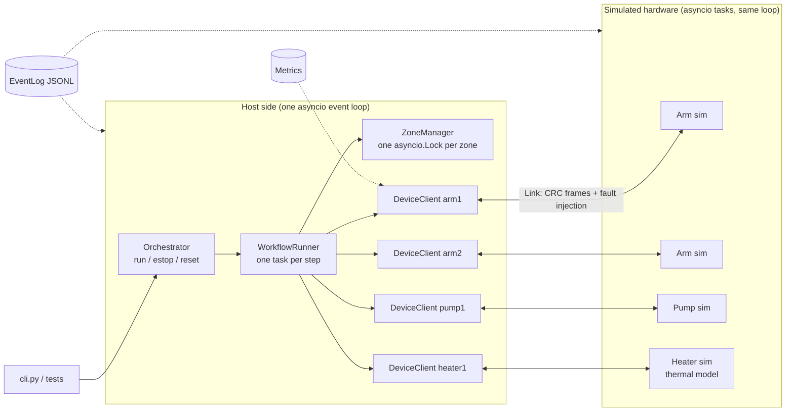
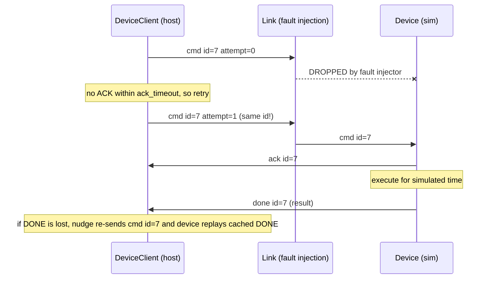

# Architecture & System Design (`minilab`)

This document outlines the architectural principles, protocol mechanics, concurrency guarantees, and engineering decisions implemented in `minilab`.

---

## 1. Goals & Non-Goals

### Goals
- **Deterministic Concurrency:** Coordinate heterogeneous subsystems (two arms, a pump, and a thermal controller) across parallel workflows without race conditions.
- **Fault-Tolerant Communication:** Tolerate lost packets, duplicates, delays, corruptions, and cable disconnections using CRC framing, acknowledgements, retries, and idempotent replies.
- **Hard Safety Guarantees:** Ensure emergency stop (e-stop) immediately halts physical motion, latches safely, releases zone locks, and aborts workflow steps within strict latency bounds.
- **Low-Latency & Diagnostic Transparency:** Measure exact latency distributions (p50/p90/p99/max) and log structured JSON-lines telemetry for post-run analysis and determinism replay.

### Non-Goals
- **Physical Hardware Interfacing:** This project runs strictly in **simulated hardware**. It does not interface directly with CAN bus, RS-485 serial, or EtherCAT microcontrollers.
- **Hard Real-Time Guarantees:** Runs on a general-purpose OS in a single Python `asyncio` loop. It does not utilize RT-Linux kernel patches or `SCHED_FIFO` preemption.
- **Complex Dependency Graph Compilation:** Workflows are standard directed acyclic graphs (DAGs) without runtime looping or conditional branches.

---

## 2. Architecture Overview

### 2.1 System Topology



### 2.2 Command & Response Lifecycle



---

## 3. Protocol & Wire Framing

Each frame sent across a `Link` consists of:
```text
<crc32_as_8_lowercase_hex>|<compact_sorted_json>
```

### Protocol Rules & Justification
1. **CRC32 Integrity Validation:** Detects payload truncations and bit-flips before JSON parsing. Any corrupt frame raises `FrameError`, is logged, and dropped without crashing reader loops.
2. **Persistent `msg_id` Across Retries:** Every retry retains the identical command identifier while incrementing the informational `attempt` counter.
3. **Receiver-Side Idempotency:** The device caches prior execution replies in `_replies[msg_id]`. Duplicate command arrivals immediately trigger ACK and reply replay without re-executing physical actions.
4. **DONE Implies ACK:** If a device finishes an instant command rapidly and its ACK was dropped, receipt of `done` or `error` implicitly satisfies the ACK wait phase.
5. **Nudge Recovery for Lost DONE:** If a command is executing or done but the host never receives the final reply before `resend_interval`, the host resends the command. The device replays its cached DONE response.

*(Note: On physical serial or TCP networks, a newline delimiter `\n` would be appended; in this in-process simulation, frames are delimited as discrete string elements in `asyncio.Queue`.)*

---

## 4. Fault Injection & Deterministic Replay

The `transport.py` module models adverse physical communication channels.

### Determinism Rules
- **String-Seeded Pseudo-Randomness:** RNG instances are initialized with deterministic string seeds (`random.Random(f"{seed}:{name}")`) to prevent Python process hash seed divergence.
- **Fixed-Order Draws:** On every transmission, random samples (`r_drop, r_corrupt, r_dup, r_delay, delay, dup_gap`) are drawn in strict sequence *before* checking condition thresholds. This guarantees that the *n*-th frame on a channel experiences identical random draws regardless of probability variations.

---

## 5. Concurrency Model

All execution runs within a single Python `asyncio` event loop.

### Concurrency Primitives
- **Step Parallelism:** `WorkflowRunner` creates one `asyncio.Task` per workflow step. Dependencies are synchronized via `asyncio.Event.wait()`.
- **Non-Preemptive Task Storage:** All spawned `asyncio.create_task()` references are preserved in sets with done-callbacks (`t.add_done_callback(tasks.discard)`) to prevent premature garbage collection.
- **Clean Cancellation Flow:** Coroutines never swallow `asyncio.CancelledError`. They catch it solely to execute cleanup in `finally` blocks (releasing locks and resetting hardware state) and re-raise.

---

## 6. Spatial Zones & Mutual Exclusion

Physical spatial zones (e.g. Zone `A`, `B`, `C`) represent overlapping robot reach volumes.

### Deadlock Prevention
- **Canonical Lock Ordering:** Contending steps acquire multiple zone locks in fixed lexicographical order (`sorted(set(zones))`), eliminating the *circular wait* condition.
- **Watchdog Acquisition Timeout:** `ZoneManager.acquire()` wraps acquisitions in `async with asyncio.timeout(timeout):`. On timeout, all partially acquired locks are released in the `except BaseException` block to prevent leaks.
- **Cycle Detection:** `ZoneManager.find_deadlock()` inspects the runtime wait-for graph and reports active deadlock cycles for diagnostics.

---

## 7. Emergency Stop (E-Stop) Mechanics

1. **Immediate Latch:** `self.estop_state.active = True` is latched immediately.
2. **Concurrent Hardware Notification:** E-stop command frames are dispatched to all devices concurrently via dedicated `client.estop()` tasks that bypass the command queue.
3. **Execution Cancellation:** Running workflow step tasks are cancelled (excluding the caller task).
4. **Safe State Transition:** Arms freeze at their current location; heaters reset target temperatures to ambient (25 °C); pumps record partial fluid volumes dispensed prior to cancellation.
5. **State Recovery (`reset`):** E-stop latch remains active until `Orchestrator.reset()` re-initializes online devices.

---

## 8. Simplifications & Engineering Trade-offs

1. **Discrete Thermal Model:** The heater simulator advances temperature by `(target - temp) * 0.1` per tick rather than continuous wall-clock differential equations.
2. **In-Process Queue Transport:** Messages travel through in-memory `asyncio.Queue[str]` instances instead of OS socket or serial device drivers.
3. **Unbounded Response Cache:** `Device._replies` caches command outcomes in memory for the life of the run, suitable for thousands of commands in testing.

---

## 9. Engineering Decisions

- **Event Log Isolation:** Avoided Python standard library `logging` in favor of an explicit `EventLog` class to guarantee monotonic timestamping (`time.perf_counter()`), zero I/O locks, and exact JSONL schema formatting.
- **Shared Future Safety (`asyncio.wait` vs `wait_for`):** In `DeviceClient`, ACK waiting utilizes `await asyncio.wait({p.ack_fut}, timeout=ack_timeout)`. Using `asyncio.wait_for` would cancel the underlying future on timeout, breaking subsequent retry matching.
- **E-Stop Concurrency Normalization:** `Orchestrator.estop()` shares an active future (`_estop_fut`) across concurrent calls, ensuring all callers receive identical safety reports.

